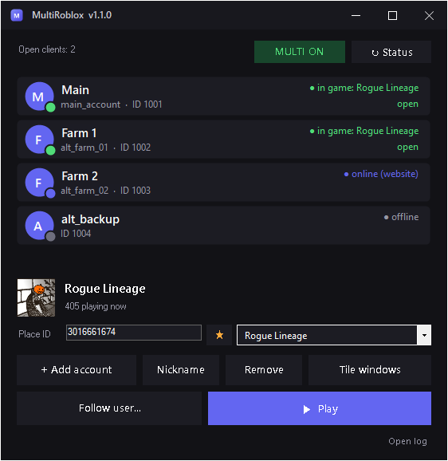

<div align="center">


# MultiRoblox

**A lightweight, dark-themed multi-client launcher and account manager for Roblox. No installer needed.**

**[Website](https://blnkdev.github.io/MultiRoblox/)** · **[Download](https://github.com/blnkDev/MultiRoblox/releases/latest)**

[](https://github.com/blnkDev/MultiRoblox/releases/latest)
[](https://github.com/blnkDev/MultiRoblox/actions)
[](LICENSE)




</div>

---

## Features

- **Multi-client:** run several Roblox accounts at the same time, each in its own client.
- **No stored passwords:** you sign in through your **default browser** (Firefox, Edge, Chrome, Brave or Vivaldi), with the normal captcha and 2FA. The program only keeps the session cookie, **encrypted** for your Windows user.
- **Launch many at once:** select the accounts and click Play. It opens them one by one, confirms each client actually started, and flags the ones that failed.
- **Nicknames** for every account: double-click it and type right on the row (Enter saves, Esc cancels).
- **Reorder accounts:** drag and drop, or `Alt`+`↑`/`↓` (moves all selected). The order is saved and also used when tiling windows.
- **Game by Place ID:** shows the name, icon and live player count. Favorite games with the star ☆ and switch between them in one click.
- **Follow user:** join the server of a friend or of another account of yours.
- **Profile pictures:** each account shows its Roblox avatar (downloaded once, cached on your PC and refreshed every 12 hours), with the colored initial as a fallback.
- **Online status:** see whether each account is offline, on the website, or in a game (and which one). A colored dot on the avatar shows it at a glance: green in game, blue online, orange in Studio, gray offline.
- **Tile windows:** arrange all clients side by side in a grid.
- **Login check on startup:** accounts whose login expired are marked in red.
- **Update notice:** checks GitHub for a newer release (on startup and every 6 hours) and shows an **Update** button in the title bar that opens the release page. It never downloads or installs anything by itself. You can turn it off in the tray menu.
- **Close one client:** right-click an account and choose **Close client** to shut down just that account's Roblox.
- **Password lock (optional):** ask for a password when the program opens. **Lock now** in the tray menu hides the window until the password is typed again. Set it from the tray icon menu.
- **Clear errors and a log:** when something fails, each account says why (expired login, rate limit, locked account, no connection), and an **Open log** button shows the details.
- **Custom UI:** dark theme, custom title bar, system tray icon.

## Installation

1. Download `MultiRoblox-vX.Y.Z.zip` from the [**Releases**](https://github.com/blnkDev/MultiRoblox/releases/latest) page.
2. Extract it and run `MultiRoblox.exe`. Nothing to install: it uses the .NET Framework that ships with Windows.
3. Optionally verify the download: `Get-FileHash MultiRoblox-vX.Y.Z.zip` should match `SHA256SUMS.txt` from the release.

> The executable is **not code-signed**, so Windows SmartScreen may warn you on first run (*More info → Run anyway*). If you would rather not trust a binary, [build it yourself](#building-from-source): it is a single source file and takes seconds.

## Usage

1. **Close every Roblox window.** The panel shows **WAITING** while a client that was opened before the program is still holding the lock. Once they are all closed it turns into **MULTI ON**.
2. **+ Add account:** your browser opens on roblox.com/login, you sign in as usual, and the account appears in the list. The temporary browser is closed and deleted automatically.
3. Enter the game's **Place ID** (or pick a favorite), select the accounts (`Ctrl`/`Shift` for several) and click **▶ Play**.
4. Use **Tile windows** to arrange the clients on screen.

> Multi-client only applies to clients opened **after** MultiRoblox, and only while it is running. Minimizing keeps it in the taskbar like any other app and multi-client keeps working; closing the window turns multi-client off.

## Security and privacy

- **No password is stored.** Only each account's `.ROBLOSECURITY` cookie, in `%APPDATA%\MultiRoblox\accounts.dat`, encrypted with the **Windows DPAPI** (only your user, on this PC, can read it).
- **No telemetry and no server of its own.** The program only talks to `*.roblox.com`, Roblox's image CDN and, for the optional update check, `api.github.com` (no account data is sent; GitHub sees your IP address like in any web request). The cookie is only ever sent to `roblox.com`.
- Sign-in uses a **temporary, empty browser profile** that is deleted afterwards. Your own browser data, tabs and saved passwords are never touched.
- ⚠️ **Anyone who has the cookie can enter the account without the password or 2FA.** Never share `accounts.dat` or the `%APPDATA%\MultiRoblox` folder.
- The optional **password lock** only locks the program window (it stores a salted PBKDF2 hash in `lock.dat`). It does not encrypt your accounts any further: `accounts.dat` stays protected by the Windows DPAPI. Treat it as protection against casual use of your PC, not against someone who controls your Windows account.
- All the source code is in this repository: you can read it, build it and compare.

## ⚠️ Important notice

- This project is **not affiliated with, approved by or endorsed by Roblox Corporation.** "Roblox" is a trademark of its owners.
- Running several clients **may violate Roblox's Terms of Use** or the rules of specific games, and **may get accounts punished or banned.** Roblox's anti-cheat may treat multiple clients as abuse. **Use it at your own risk**, preferably with disposable accounts.
- Multi-client relies on a mechanism of the Roblox client that **may change or stop working with any update.** If that happens, the second client will close the first one again and there is nothing this program can do about it.
- Do not use it to cheat, automate farming or harm other players. The project has no macros, anti-AFK or game automation.

## How it works

<details>
<summary>Technical details</summary>

- **Multi-client:** Roblox blocks a second client using the `ROBLOX_singletonMutex` and `ROBLOX_singletonEvent` objects. The program holds both Windows objects so the client believes it is the only one. Nothing is injected and no Roblox memory is read.
- **Sign-in:** opens the default browser (read from the Windows registry) with a temporary profile and a local debugging port. **Chromium** browsers (Edge, Chrome, Brave, Vivaldi) use the Chrome DevTools Protocol; **Firefox** uses WebDriver BiDi. The cookie is read through that channel, validated against `users.roblox.com`, and the browser is closed.
- **Launching a game:** exchanges the cookie for a one-time *authentication ticket* (`auth.roblox.com`) and opens the `roblox-player:` protocol, the same way the website does.
- **Storage:** `accounts.dat` = DPAPI (current user scope). Favorites and the last game are plain text (`favs.txt`, `place.txt`). Errors go to `log.txt` (never the cookie).
- **Windows:** tiling uses `SetWindowPos` with Roblox's DPI awareness, so sizes come out right on scaled displays.

Files in `%APPDATA%\MultiRoblox\`: `accounts.dat`, `favs.txt`, `place.txt`, `log.txt`, the `avatars\` folder (cached profile pictures) and, if you set a password, `lock.dat`. To remove everything, delete the folder.

</details>

## Known limitations

- Windows 10/11 only, and the Roblox client installed from the website (the `roblox-player:` protocol).
- Tiling only uses the primary monitor.
- Browsers other than Firefox and Chromium-based ones (Opera, for example) fall back to Edge or Chrome for sign-in.

## Building from source

Nothing to install: the C# compiler already ships with Windows (`csc.exe`, .NET Framework 4).

```powershell
git clone https://github.com/blnkDev/MultiRoblox.git
cd MultiRoblox
.\build.ps1          # builds dist\MultiRoblox.exe and runs the self-test
.\build.ps1 -Zip     # also creates dist\MultiRoblox-vX.Y.Z.zip and SHA256SUMS.txt
```

Command-line options (for development):

| Option | What it does |
|---|---|
| `--demo` | opens with fake accounts and **writes nothing** (used for screenshots) |
| `--selftest` | checks the window grid; exits with code 0 if it is fine |
| `--logintest` | opens the default browser with no window and no sign-in and checks the protocol; 0 = ok |
| `--makeico <file>` | generates the program's `.ico` |

Setting the `MULTIROBLOX_DATA` environment variable to a folder makes the program use that folder instead of `%APPDATA%\MultiRoblox`, which is handy for testing without touching real accounts.

Layout:

```
src/MultiRoblox.cs     source code (single file)
src/AssemblyInfo.cs    version and metadata (source of truth for the version)
assets/                program icon
docs/                  project website (GitHub Pages) and README screenshot
build.ps1              build + self-test + package
.github/workflows/     CI and release publishing
```

## Versioning and releases

The project follows [SemVer](https://semver.org/) and keeps a [CHANGELOG](CHANGELOG.md). The version lives in `src/AssemblyInfo.cs`.

To cut a release:

1. Bump the version in `src/AssemblyInfo.cs` and add its section to `CHANGELOG.md`.
2. Commit and tag: `git tag -a vX.Y.Z -m "vX.Y.Z" && git push --follow-tags`.
3. GitHub Actions builds, runs the self-test and publishes the release with the `.zip` and `SHA256SUMS.txt`, using the CHANGELOG notes. The tag must match the version in `AssemblyInfo.cs`.

## Ideas for the future

Per-account game · start with Windows (minimized) · optional password to open the program · choose the monitor when tiling windows.

## License

[MIT](LICENSE) © 2026 Oliveira Neto
